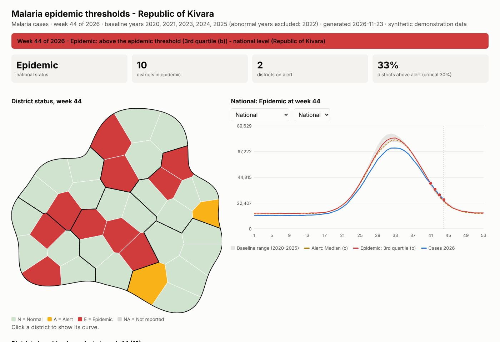
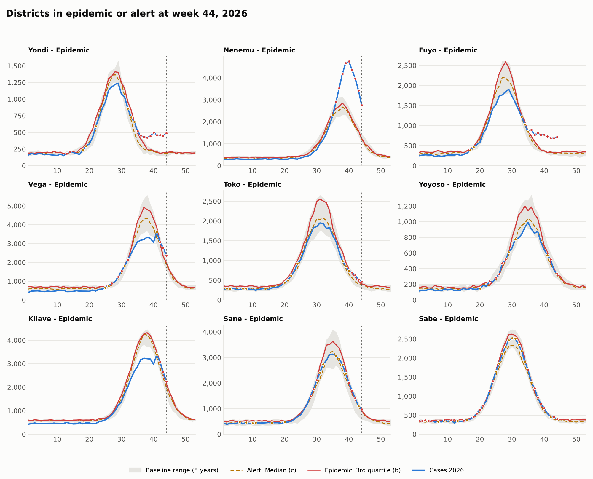
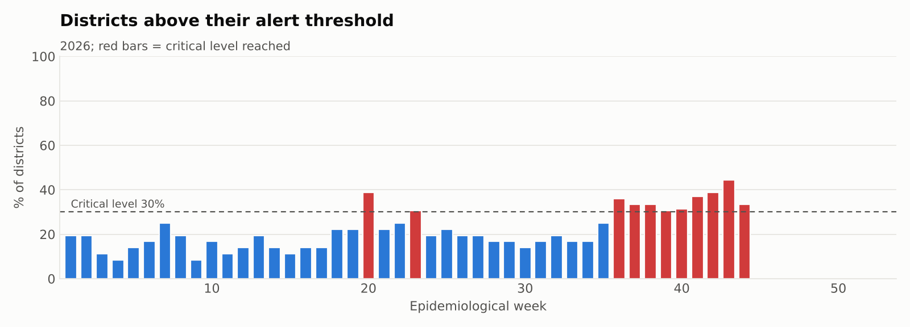
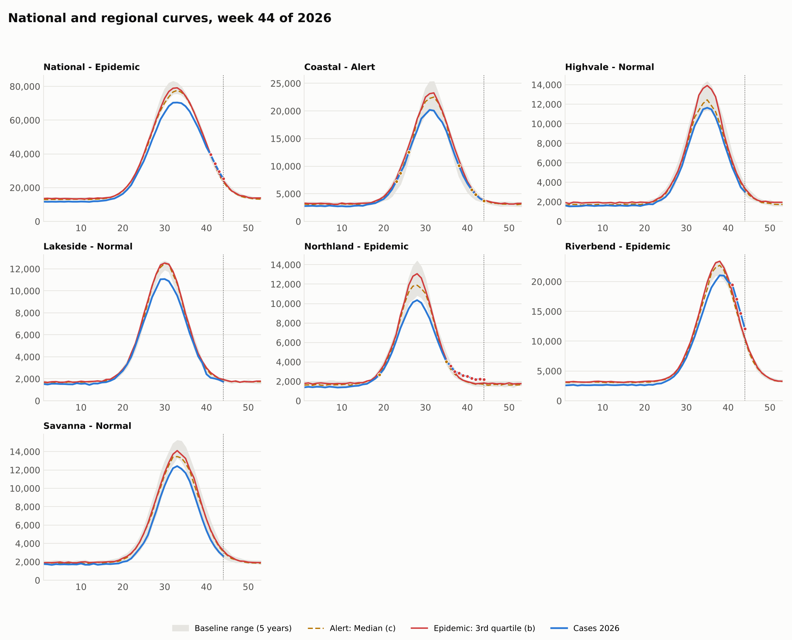
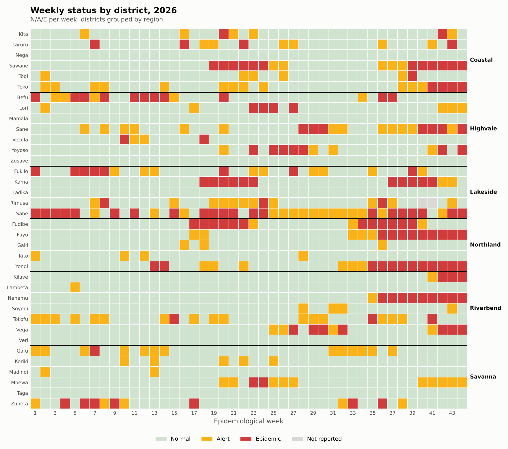

# Malaria epidemic thresholds

[](https://github.com/stevebanza/malaria-epidemic-thresholds/actions/workflows/ci.yml)

**Is the number of malaria cases this week normal *for this week of the year*?**

This is the question behind epidemic detection. The answer comes from history: this week's cases are compared with **the same epidemiological week in the five previous years**. If they are higher than that history allows, the district is on **Alert**; if they are higher still, it is in **Epidemic**.

This repository is a Python version of a weekly malaria epidemic-threshold tool I developed in Excel and use with national malaria programmes. It reproduces the same method, measure by measure, and adds what is hard to do in a workbook:
- every district analysed in one run;
- an offline HTML dashboard;
- an automated test for each rule.

> **The data is synthetic.** The districts of the "Republic of Kivara" and all figures are invented. There is no country data in this repository.



---

## How a threshold is built

Take week 44 of 2026 in one district:

1. **Choose the selected year and week.** The week is either set by hand or `auto`: the last week reported nationally.
2. **Take the same week, 44, in the five previous years.** This is the baseline.
3. **Skip abnormal years.** If a year is listed as abnormal (a past epidemic, a reporting break), it is **replaced by the year before it**, so the baseline always has five years. With 2022 declared abnormal, the baseline for 2026 is 2020, 2021, 2023, 2024 and 2025.
4. **Compute the two thresholds** from those five values: an alert threshold and a higher epidemic threshold, using the measures chosen below. Zero values count as *not reported* and are left out.
5. **Compare week 44 of 2026 with them:**

| Code | Status | Rule |
| :---: | --- | --- |
| **E** | Epidemic | cases > epidemic threshold |
| **A** | Alert | cases > alert threshold |
| **N** | Normal | otherwise; continue routine surveillance |
| **NA** | Not reported | no value, or 0 |

Each week stands on its own: one week above the epidemic threshold is an **E**. Previous weeks of the current year play no part in the threshold.

This is done at three levels, each on **its own summed cases**:
- **national** (all districts added together);
- **Admin1** (regions or provinces);
- **Admin2** (districts).

A region's threshold is therefore computed from the region's totals, not by adding up district thresholds.

---

## The measures

| Code | Measure | Computed on the 5 baseline values of week *w* | Can be used as |
| :---: | --- | --- | --- |
| a | 1st quartile | 25th percentile | Alert |
| d | C-SUM | mean of weeks *w−1*, *w*, *w+1* (15 values) | Alert |
| c | Median | 50th percentile | Alert or epidemic |
| b | 3rd quartile | 75th percentile | Alert or epidemic |
| e | 85th centile | 85th percentile | Epidemic |
| f | Mean + 2 SD | mean + 2 standard deviations | Epidemic |

The epidemic threshold must be higher than the alert threshold, so only these pairs are accepted:

| Alert threshold | Allowed epidemic thresholds |
| --- | --- |
| 1st quartile (a) or C-SUM (d) | median, 3rd quartile, 85th centile, mean + 2 SD |
| Median (c) | 3rd quartile, 85th centile, mean + 2 SD |
| 3rd quartile (b) | 85th centile, mean + 2 SD |

The default is **median → 3rd quartile**.

**Strengths and limits of each measure:**

| Measure | Strengths | Limits |
| --- | --- | --- |
| Quartiles, median, 85th centile | Moderately sensitive. Not pulled up by an abnormal year, unlike mean + 2 SD. Simple to compute without weighting by health facility. | Can miss large epidemics, especially in low and very low transmission areas. |
| C-SUM | Very sensitive; detects even minor epidemics. Best suited to very low transmission settings where elimination has started and any resurgence counts as an epidemic. | Can produce false alarms in moderate transmission areas with frequent epidemics. Less suited to highly seasonal settings. |
| Mean + 2 SD | Less sensitive to minor peaks; avoids over-reaction in stable transmission areas with small seasonal fluctuations. | Can miss large epidemics in low transmission areas. Pulled up by any year with very high case numbers, so abnormal years must be excluded. |

**The same week under different choices** (sample data, week 44, 36 districts):

| Alert → Epidemic | Epidemic | Alert | Normal |
| --- | ---: | ---: | ---: |
| 1st quartile → median | 12 | 9 | 15 |
| C-SUM → median | 12 | 0 | 24 |
| **Median → 3rd quartile** (default) | **10** | **2** | **24** |
| Median → 85th centile | 7 | 5 | 24 |
| Median → mean + 2 SD | 4 | 8 | 24 |
| 3rd quartile → mean + 2 SD | 4 | 6 | 26 |

The choice of measures is a programme decision. It depends on the level of transmission and on how much the team can afford to investigate each week. The tool lets a team test the choice on its own history before adopting it.

---

## Worked example: Yondi district, week 44 of 2026

The five baseline values for week 44 give:

| 1st quartile | Median | C-SUM | 3rd quartile | 85th centile | Mean + 2 SD |
| ---: | ---: | ---: | ---: | ---: | ---: |
| 176 | 182 | 186 | 198 | 208 | 245 |

Yondi reported **489 cases**: 2.5 times the 3rd quartile, so the status is **E**. It is no isolated week. Every week since week 38 has been more than twice its own threshold:

| Week | Cases | Alert (median) | Epidemic (3rd quartile) | Status |
| ---: | ---: | ---: | ---: | :---: |
| 38 | 421 | 222 | 248 | E |
| 40 | 500 | 215 | 223 | E |
| 42 | 458 | 184 | 185 | E |
| 44 | 489 | 182 | 198 | E |

The cases are flat (about 450 a week), but the thresholds fall as the season ends. A district that "isn't getting worse" can still be far above what is normal for the time of year.



---

## Why abnormal years are skipped and replaced

The sample has a national epidemic in 2022: 3.16 million cases, almost twice the usual 1.64 million. The workbook's *Abnormal year check* sheet flags such years as candidates. Whether to list a year as abnormal remains the programme's decision.

| Baseline for 2026 | National week 33 thresholds (median / 3rd quartile) | Districts in epidemic at week 44 |
| --- | --- | ---: |
| 2020, 2021, 2023, 2024, 2025 (2022 replaced by 2020) | 77,632 / 79,142 | **10** |
| 2021–2025 (2022 kept) | 79,142 / 82,099 | 7 |

Keeping 2022 raises the thresholds and **hides three epidemics**.

---

## National picture: how many districts are above their alert threshold?

Besides each district's status, the tool tracks the **share of reporting districts above their alert threshold** every week. It compares that share with a critical level, 30% by default. In the sample, the critical level is reached in 11 weeks of 2026, including every week from 39 to 44.





---

## Data checks

Before any status is trusted, the data is checked district by district. Within each district-year:
- weeks **above the mean + 2 SD of that year** are flagged as unusually high;
- weeks **below the mean − 2 SD** are flagged as possibly missing or under-reported.

In the threshold sheets, baseline values outside the mean ± 2 SD for their week are shown in red italics, as in the original tool.

---

## Input

The workbook layout national teams already use: one sheet of cases and one of deaths, each with one row per district and year and one column per epidemiological week.

| District | Region | Year | W1 | W2 | … | W53 |
| --- | --- | ---: | ---: | ---: | --- | ---: |
| Yondi | Northland | 2025 | 196 | 188 | … | |
| Yondi | Northland | 2026 | 171 | 180 | … | |

A French workbook is used as it is, by mapping its headers in `config.yaml`:

```yaml
sheets:
  cases: Cas hebdo
  deaths: Décès hebdo
columns:
  district: Districts
  region: Regions
  year: Année
  week_prefix: S        # S1..S53
```

The analysis can run on **cases or deaths** (`indicator`). District boundaries (GeoJSON) are used for the map.

## Outputs

**The workbook, `malaria_thresholds_<year>_W<week>.xlsx`, laid out like the original tool:**

| Sheet | Contents |
| --- | --- |
| Settings | year, week, measures, baseline years, abnormal years |
| Week *n* status | every district: status, cases, both thresholds, cases ÷ epidemic threshold |
| Summary N-A-E | districts × weeks, colour-coded |
| National / Admin1 / Admin2 | for each unit: the 5 baseline years, the selected year, the alert and epidemic thresholds for weeks 1–53 |
| % districts above alert | weekly share against the critical level |
| Data checks | unusually high or low weeks |
| Abnormal year check | national totals per year, with candidates for the abnormal list |

**The dashboard, `malaria_dashboard_<year>_W<week>.html`,** is one file that works offline. It contains:
- the national status banner;
- the district map (click a district to see its curve);
- a curve for any unit at national, Admin1 or Admin2 level;
- the list of districts in epidemic or alert;
- the weekly N/A/E summary;
- the share of districts above alert.

**Charts** (PNG, for bulletins): status map, weekly summary heatmap, national and regional curves, district curves, share above alert.



---

## Running it

```bash
python -m venv .venv && source .venv/bin/activate     # Windows: .venv\Scripts\activate
pip install -r requirements.txt
python run_analysis.py
pytest -q
```

```
Week 44 of 2026 - Epidemic: above the epidemic threshold (3rd quartile (b)) - national level
Baseline years: [2020, 2021, 2023, 2024, 2025] (abnormal years skipped: [2022])
  E  Yondi      Northland       489 cases, 2.47 x epidemic threshold
  E  Nenemu     Riverbend     2,760 cases, 2.22 x epidemic threshold
  ...
```

Every week, update the workbook and run again. The week is detected automatically. To review a past year, change `selected_year`.

The 11 tests check each rule of the original tool:
- abnormal years are replaced by earlier years;
- each measure matches the Excel formula, including C-SUM as a plain 3-week mean and the sample standard deviation;
- zeros are ignored;
- the status is decided one week at a time;
- only valid threshold pairs are accepted;
- each level uses its own summed cases;
- a French-format workbook gives identical thresholds.

```
config.yaml          selected year and week, measures, abnormal years, critical %, column mapping
malthresh/
  thresholds.py      baseline years, the six measures, weekly status, data checks
  excel.py           workbook laid out like the original tool
  charts.py          map, heatmap, curves, share above alert
  dashboard.py       offline HTML dashboard
  synthetic.py       sample data
  pipeline.py        runs everything at the three levels
```

---

## Résumé en français

Pour chaque semaine de l'année choisie, l'outil compare le nombre de cas à **la même semaine des cinq années précédentes**. Les années anormales sont exclues et remplacées par l'année antérieure. Il calcule un **seuil d'alerte** et un **seuil épidémique**, au choix parmi : 1er quartile, C-SUM, médiane, 3e quartile, 85e centile, moyenne + 2 écarts-types. Le statut de chaque semaine est N (normal), A (alerte), E (épidémie) ou NA (non rapporté), au niveau national, régional et du district. Il lit directement le classeur habituel (Districts, Régions, Année, S1…S53) et produit un classeur Excel et un tableau de bord HTML hors ligne. Les données de ce dépôt sont fictives.

---

Steve KUBENGA BANZA, PMP · Data Management and Analytics · [LinkedIn](https://www.linkedin.com/in/stevekubengabanza/) · MIT License
