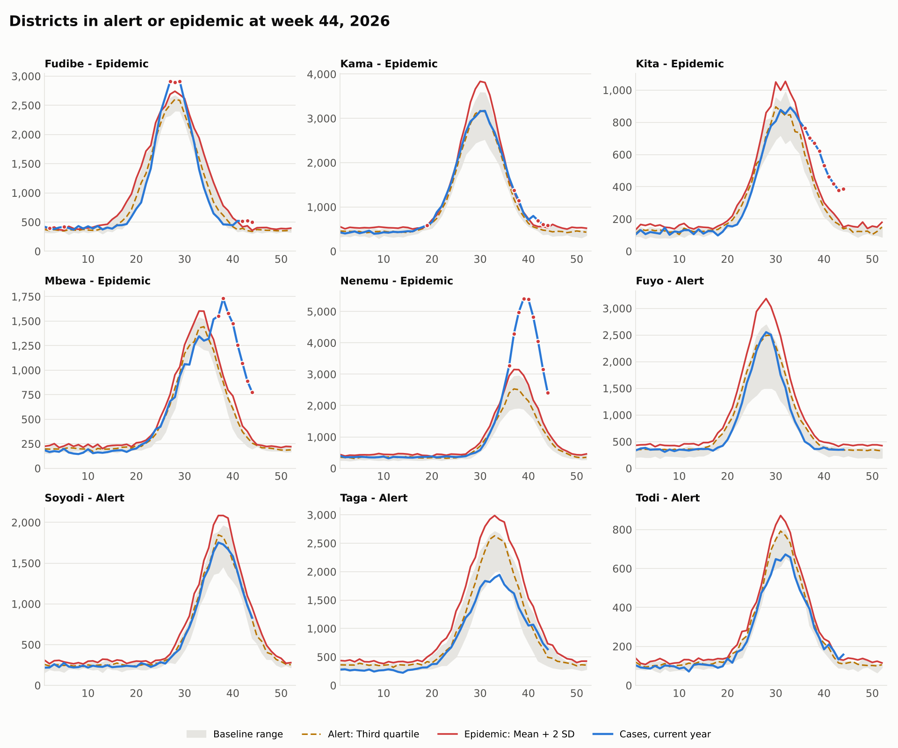

# Malaria epidemic thresholds

[](https://github.com/stevebanza/malaria-epidemic-thresholds/actions/workflows/ci.yml)

**Every Monday, a malaria surveillance officer has to answer one question: *is the number of cases in each district normal for this time of year, or is an epidemic starting?***

This tool answers it from the weekly district data the team already collects. For each district and week it compares this year's cases with the same weeks of the previous five years. It then marks each district **Normal**, **Alert** or **Epidemic** and produces the files the team needs to act on: a colour-coded Excel workbook and an offline dashboard.

> **The data is synthetic.** The districts of the "Republic of Kivara" and all figures are invented for this demonstration. The methods are those of WHO guidance on malaria epidemic detection and are used in real national surveillance work.


---

## This week's result (sample data, week 44 of 2026)

```
Week 44 of 2026: 5 district(s) in epidemic, 7 on alert, 24 normal or not reported.
  EPIDEMIC  Fudibe     Northland  above alert since week 40
  EPIDEMIC  Kama       Lakeside   above alert since week 33
  EPIDEMIC  Kita       Coastal    above alert since week 31
  EPIDEMIC  Mbewa      Savanna    above alert since week 35
  EPIDEMIC  Nenemu     Riverbend  above alert since week 32
```

| District | Cases, week 44 | Epidemic threshold | Last 4 weeks vs threshold |
| --- | ---: | ---: | ---: |
| Nenemu | 2,405 | 1,160 | 14,443 vs 6,707 (2.2×) |
| Mbewa | 774 | 293 | 3,990 vs 1,682 (2.4×) |
| Kita | 387 | 150 | 1,648 vs 846 (1.9×) |
| Kama | 583 | 528 | 2,680 vs 2,238 (1.2×) |
| Fudibe | 499 | 357 | 2,059 vs 1,716 (1.2×) |

Nenemu, Mbewa and Kita are running at roughly twice their epidemic threshold: these are clear epidemics. Kama and Fudibe are just above it, so the first step there is to check the data before mobilising a response.

---

## Reading a district curve



Each panel shows one district:
- **grey band:** the lowest-to-highest weekly cases in the baseline years;
- **dashed amber line:** the alert threshold (third quartile);
- **red line:** the epidemic threshold (mean + 2 SD);
- **blue line:** this year's cases. Red dots mark *Epidemic* weeks.

**Worked example: Kita, Coastal region.** The usual seasonal peak (around week 30, about 860 cases) passed normally. Then cases rose again when they should have been falling:

| Week | Cases | Alert threshold | Epidemic threshold | Status |
| ---: | ---: | ---: | ---: | --- |
| 38 | 671 | 407 | 454 | Epidemic |
| 40 | 533 | 269 | 302 | Epidemic |
| 42 | 420 | 186 | 234 | Epidemic |
| 44 | 387 | 139 | 150 | Epidemic |

Kita's cases are falling week on week, which might look reassuring. But the thresholds are falling faster, because this is normally the end of the season. Kita is at 2.6× its expected level, so comparing with last week is not enough. **Compare with the same week in normal years.**

---

## Why past epidemic years must be excluded

A threshold built from years that include an epidemic is too high, and it hides the next epidemic.

In the sample, Kilave district had an epidemic in 2022. The tool detects it automatically: 138,778 cases that year, against a median of 65,300 in its other baseline years. The effect on the threshold at week 38:

| Baseline | Alert threshold | Epidemic threshold |
| --- | ---: | ---: |
| 2021-2025 with 2022 excluded (default) | 3,782 | **4,174** |
| 2021-2025 with 2022 kept | 4,074 | **11,629** |

With 2022 left in, Kilave would need almost three times as many cases before an epidemic was flagged. Every excluded district-year is listed with its reason in the *Baseline years* sheet, so the choice can be reviewed and overridden in `config.yaml`.

---

## Choosing the thresholds

| Method | How it's computed | Behaviour | Typical use |
| --- | --- | --- | --- |
| Third quartile (`q3`) | 75th percentile of week *w* in the baseline | Sensitive; robust to one unusual year | **Alert** (default) |
| Mean + 2 SD (`mean_2sd`) | Mean of week *w* + 2 standard deviations | More specific; pushed up by any extreme year, hence the exclusion step | **Epidemic** (default) |
| C-SUM (`csum`) | Mean of weeks *w−1*, *w*, *w+1* + 1.96 SD | Smoother; less noisy when weekly counts are small | Low-transmission or small districts |

A district is declared **Epidemic** only after **2 consecutive weeks** above the epidemic threshold (`consecutive_weeks`), so a single late or batched report doesn't trigger it. A first week above is shown as **Alert**. Unreported weeks are shown as **No data** and are never treated as zero.

All three thresholds are saved in the workbook, so a team can compare methods on its own history before choosing.

---

## What each status calls for

This is a starting point; national guidelines take precedence.

| Status | First actions |
| --- | --- |
| **Alert** | Check the data: late or batched reports, a new health facility, a change in testing (more RDTs). Confirm the share of positive tests. Check stocks of RDTs and ACTs. Watch the following week. |
| **Epidemic** | Notify the district and national teams. Investigate (cases by age and village, deaths, test positivity). Pre-position commodities. Plan the response: case management, vector control, communication. |
| **No data** | Follow up the missing reports. A silent district during the season is a risk in itself. |

---

## The weekly routine

1. Receive the updated workbook (all districts, current year up to the last complete week).
2. Set `last_week` in `config.yaml`.
3. Run `python run_analysis.py`. It takes a few seconds.
4. Open the dashboard. Start with the list of districts in alert or epidemic, then click each one on the map to see its curve.
5. Share the Excel workbook with the team and the district focal points.


The heatmap shows the whole year at a glance:
- an epidemic shows as a run of red;
- persistent amber early in the year (Nega, Sawane) suggests this year's level is generally higher, or that the baseline years were low. That's worth a data check rather than a response.

---

## Input: the workbook you already have

One sheet of cases, with one row per district and year and one column per epidemiological week:

| District | Region | Year | W1 | W2 | … | W53 |
| --- | --- | ---: | ---: | ---: | --- | ---: |
| Kita | Coastal | 2025 | 118 | 131 | … | 142 |
| Kita | Coastal | 2026 | 103 | 120 | … | |

A French workbook is used as it is: only the column names are mapped in `config.yaml`.

```yaml
sheets:
  cases: Cas
columns:
  district: Districts
  region: Province
  year: Année
  week_prefix: S        # S1..S53
```

District boundaries (GeoJSON, one feature per district with a `district` property) are used for the map.

## Outputs

- **`malaria_dashboard_<year>_W<week>.html`**: one file that works offline and can be sent by email. It contains:
  - a status map (click a district to see its curve, hover for exact figures);
  - the list of districts in alert or epidemic;
  - the weekly heatmap;
  - the national curve.
- **`malaria_thresholds_<year>_W<week>.xlsx`**, with these sheets:
  - *Summary*;
  - *Status* (N / A / E, colour-coded);
  - *Cases* (coloured by status);
  - one sheet of thresholds per method (district × week);
  - *Baseline years* (with exclusion reasons).
- **`charts/`**: status map, heatmap, district curves and national curve as PNG files, ready for a bulletin.

---

## Limitations

- **It needs history:** at least 3 years, ideally 5, of complete weekly data per district. Districts that were recently split or created need their history rebuilt first.
- **It works on cases, not incidence:** a growing population raises cases slowly. For long baselines in fast-growing areas, consider rates per 1,000.
- **Changes in testing or reporting** (scale-up of RDTs, community case management, new facilities) raise cases without any epidemic. That's why Alert is a prompt to check, not a conclusion.
- **Small numbers:** a district with very few weekly cases gives unstable thresholds. C-SUM or aggregating to a higher level works better there.
- **Week 53:** when a baseline year has no week 53, its week 52 is used.

---

## Quick start

```bash
python -m venv .venv && source .venv/bin/activate     # Windows: .venv\Scripts\activate
pip install -r requirements.txt
python run_analysis.py
pytest -q                                              # 9 tests
```

The tests check four things:
- the thresholds against a hand calculation;
- the 2-consecutive-weeks rule;
- that the planted 2022 epidemic is excluded in exactly the right five districts;
- that a French-format workbook gives identical results.

```
config.yaml          current week, methods, baseline length, exclusions, column mapping
malthresh/
  thresholds.py      reading the workbook, baseline years, thresholds, weekly status
  charts.py          map, heatmap, curves
  excel.py           colour-coded workbook
  dashboard.py       offline HTML dashboard
  synthetic.py       sample data and French-layout writer
  pipeline.py        runs everything
```

---

## Résumé en français

Cet outil calcule, pour chaque district et chaque semaine épidémiologique, des **seuils d'alerte** (troisième quartile) et des **seuils épidémiques** (moyenne + 2 écarts-types, ou C-SUM) à partir des cinq années précédentes. Il classe ensuite chaque district en *Normal*, *Alerte* ou *Épidémie*. Les années épidémiques passées sont exclues automatiquement de la période de référence. Il lit directement un classeur au format habituel (Districts, Province, Année, S1…S53) et produit un classeur Excel coloré et un tableau de bord HTML utilisable hors ligne. Les données de ce dépôt sont fictives.

---

Steve KUBENGA BANZA, PMP · Data Management and Analytics · [LinkedIn](https://www.linkedin.com/in/stevekubengabanza/) · MIT License
